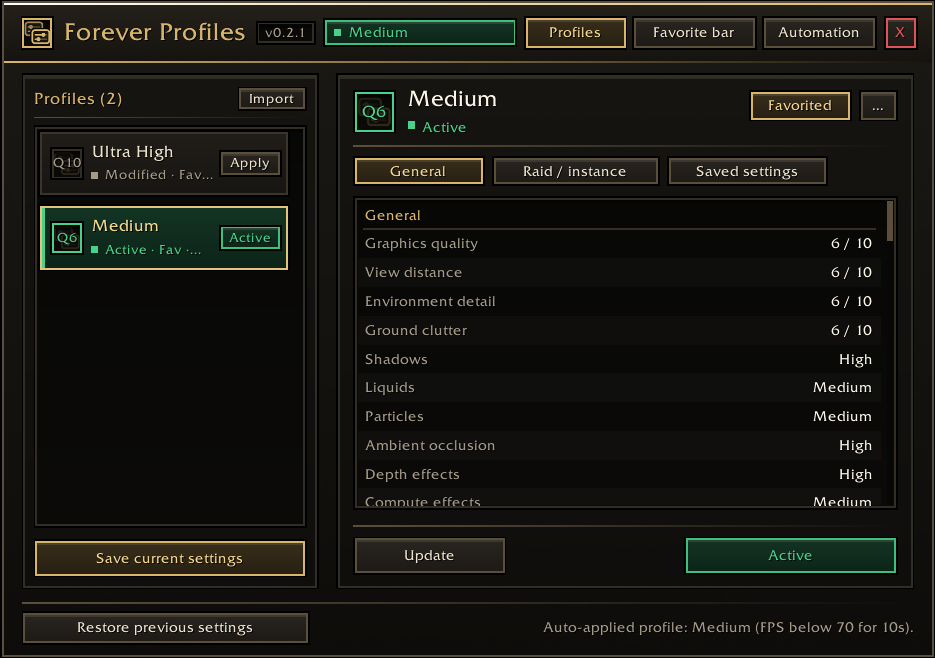
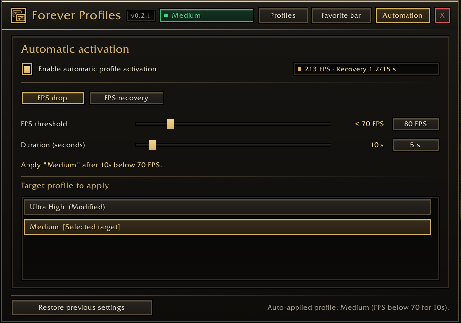
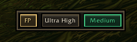
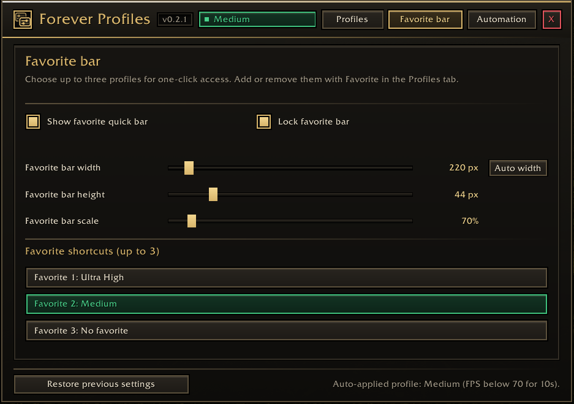

**Tired of FPS drops in busy cities or crowded areas?**

Save custom graphics profiles for **WoW Forever** and switch between them in one click, with keyboard shortcuts, or automatically when your FPS changes.

## Features

- Save and manage up to **40 graphics profiles**.
- Capture general and separate raid settings, including supported render scale, FPS limits, ground clutter fade, and sharpening options.
- Open **Saved settings** to see every graphics setting captured in a profile, including its exact value.
- Switch quickly using a **3-profile favorites bar**. Move or lock it and adjust its width, height, and scale independently.
- Share configurations using **Import** and **Export**.
- Restore the settings used before your last switch during the current session. The restore point resets when you reload the UI or restart the game.

## Getting started

1. Configure your graphics in the game and click **Apply**.
2. Open **`/fp`** and select **Save current settings**.
3. Save another configuration, then add your profiles to favorites.

Create your own setups for exploration, busy areas, or multitasking. Saved profiles are shared across your characters on the same account and installation.

## Automatic profile switching

Open **Automation** and enable automatic profile activation. Use **FPS drop** to select a performance profile, then optionally use **FPS recovery** to select the profile you want to return to. Each rule has its own FPS threshold and duration.

For example, apply **Medium** after 5 consecutive seconds below 80 FPS. While **Medium** is active, return to **Ultra High** after 15 consecutive seconds above 100 FPS.

## Screenshots

**Manage your profiles**

**Configure automatic profile switching**

**Switch with one click**

**Customize the favorites bar**

